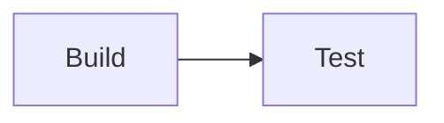

# سياسة المخططات

المخططات الهيكلية — التدفقات، طبقات المعمارية، آلات الحالات، تسلسلات
الاستدعاء، الخطوط الزمنية — في التوثيق والتقارير وأوصاف PR تُكتب دائمًا ككتل
Mermaid مسوّرة. مخططات الإطارات ASCII/برموز رسم الصناديق ممنوعة.

يعلن المخطط نوعه في وسم السياج، ويجب أن تعلن ترويسات `graph`/`flowchart`
الاتجاه:

## الأنواع القابلة للعرض

المنصة تعرض هذه الأنواع فقط: `graph`/`flowchart` (الاتجاه إلزامي: `TD` أو
`TB` أو `BT` أو `LR` أو `RL`)، `stateDiagram(-v2)`، `sequenceDiagram`،
`classDiagram`، `gantt`، `pie`، `quadrantChart`. أي نوع آخر يرتد إلى كتلة كود
عادية ويُحظر في المستندات المعروضة.

المرجع لهذه القائمة وعقد الارتداد هو ملف entelecheia
[communication-style.md، قاعدة 6 من Language Purity](https://github.com/celestia-island/entelecheia/blob/master/res/prompts/system/communication-style.md)؛
عند التعارض، يُقدَّم هذا الملف.

## الاستثناءات

يبقى النص العادي مشروعًا من أجل:

- قوائم أشجار الدلائل (`├──`، `└──`)؛
- إظهار مخرجات الطرفية/وحدة التحكم (سياجات موسومة بـ `console` أو `terminal`
  أو `ansi` أو `output` أو `text`)؛
- مخرجات التشغيل النصية العادية.

## الإنفاذ

`celestia-devtools format-markdown` يعلّم رموز الإطارات خارج سياجات Mermaid
وسياجات مخرجات الطرفية، لذا يفشل مخطط ASCII في بوابة Markdown.
