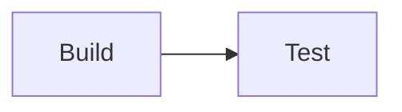

# Diagram Policy

Structural diagrams — flows, architecture layers, state machines, call
sequences, timelines — in documentation, reports, and PR descriptions are
always written as fenced Mermaid blocks. ASCII/box-drawing frame diagrams are
forbidden.

A diagram declares its kind in the fence tag, and `graph`/`flowchart` headers
must declare a direction:

## Renderable kinds

Only these kinds render on the platform: `graph`/`flowchart` (direction
required: `TD`, `TB`, `BT`, `LR`, or `RL`), `stateDiagram(-v2)`,
`sequenceDiagram`, `classDiagram`, `gantt`, `pie`, `quadrantChart`. Every
other kind falls back to a plain code block and is forbidden in rendered docs.

The authority for this list and for the fallback contract is entelecheia
[communication-style.md, Language Purity rule 6](https://github.com/celestia-island/entelecheia/blob/master/res/prompts/system/communication-style.md);
on conflict, that file wins.

## Exemptions

Plain text stays legal for:

- directory-tree listings (`├──`, `└──`);
- terminal/console output depictions (fences tagged `console`, `terminal`,
  `ansi`, `output`, or `text`);
- plain-text runtime output.
- a `text` fence is for terminal output only — it is not a loophole for frame diagrams;

## Enforcement

`celestia-devtools format-markdown` flags box-frame glyphs outside Mermaid and
terminal-output fences, so an ASCII frame diagram fails the Markdown gate.
