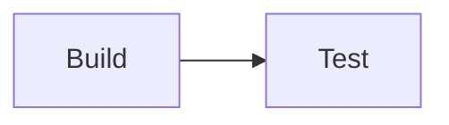

# Política de diagramas

Los diagramas estructurales — flujos, capas de arquitectura, máquinas de
estado, secuencias de llamadas, cronologías — en la documentación, los
informes y las descripciones de PR se escriben siempre como bloques Mermaid
vallados. Los diagramas de marcos ASCII con caracteres de caja están prohibidos.

Un diagrama declara su tipo en la etiqueta del vallado, y las cabeceras
`graph`/`flowchart` deben declarar una dirección:

## Tipos renderizables

Solo estos tipos se renderizan en la plataforma: `graph`/`flowchart`
(dirección obligatoria: `TD`, `TB`, `BT`, `LR` o `RL`), `stateDiagram(-v2)`,
`sequenceDiagram`, `classDiagram`, `gantt`, `pie`, `quadrantChart`. Cualquier
otro tipo se degrada a un bloque de código plano y está prohibido en los
documentos renderizados.

La autoridad de esta lista y del contrato de degradación es entelecheia
[communication-style.md, regla 6 de Language Purity](https://github.com/celestia-island/entelecheia/blob/master/res/prompts/system/communication-style.md);
en caso de conflicto, gana ese archivo.

## Exenciones

El texto plano sigue siendo legal para:

- listados de árboles de directorios (`├──`, `└──`);
- representaciones de salida de terminal/consola (vallados etiquetados
  `console`, `terminal`, `ansi`, `output` o `text`);
- salidas de ejecución en texto plano.
- una valla `text` es solo para salida de terminal — no es una escapatoria para diagramas de marcos;

## Aplicación

`celestia-devtools format-markdown` marca los glifos de marco fuera de los
vallados Mermaid y de terminal, así que un diagrama ASCII suspende la puerta
de Markdown.
