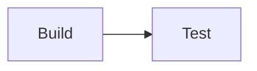

# Politique des diagrammes

Les diagrammes structurels — flux, couches d'architecture, machines à états,
séquences d'appels, frises chronologiques — dans la documentation, les
rapports et les descriptions de PR s'écrivent toujours sous forme de blocs
Mermaid clôturés. Les diagrammes en cadres ASCII/caractères de tracé sont
interdits.

Un diagramme déclare son type dans l'étiquette du bloc, et les en-têtes
`graph`/`flowchart` doivent déclarer une direction :

## Types restituables

Seuls ces types sont restitués par la plateforme : `graph`/`flowchart`
(direction obligatoire : `TD`, `TB`, `BT`, `LR` ou `RL`), `stateDiagram(-v2)`,
`sequenceDiagram`, `classDiagram`, `gantt`, `pie`, `quadrantChart`. Tout autre
type retombe sur un bloc de code brut et est interdit dans les documents
restitués.

L'autorité de cette liste et du contrat de repli est entelecheia
[communication-style.md, règle 6 de Language Purity](https://github.com/celestia-island/entelecheia/blob/master/res/prompts/system/communication-style.md) ;
en cas de conflit, ce fichier prime.

## Exemptions

Le texte brut reste légal pour :

- les arborescences de répertoires (`├──`, `└──`) ;
- les reconstitutions de sortie de terminal/console (blocs étiquetés
  `console`, `terminal`, `ansi`, `output` ou `text`) ;
- les sorties d'exécution en texte brut.

## Application

`celestia-devtools format-markdown` signale les glyphes de cadre hors des
blocs Mermaid et de terminal ; un diagramme ASCII fait donc échouer le
contrôle Markdown.
