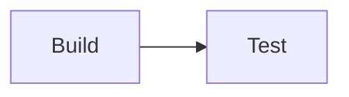

# ダイアグラム方針

ドキュメント・レポート・PR 説明における構造図（フロー、アーキテクチャ層、
ステートマシン、呼び出しシーケンス、タイムライン）は、常に Mermaid の
フェンスブロックとして書きます。ASCII/罫線文字による枠図は禁止です。

ダイアグラムはフェンスタグで種別を宣言し、`graph`/`flowchart` のヘッダーは
方向を宣言する必要があります：

## 描画可能な種別

プラットフォームで描画できるのは次の種別のみです：`graph`/`flowchart`
（方向の宣言が必須：`TD`、`TB`、`BT`、`LR`、`RL`）、`stateDiagram(-v2)`、
`sequenceDiagram`、`classDiagram`、`gantt`、`pie`、`quadrantChart`。それ以外の
種別は素のコードブロックにフォールバックし、描画されるドキュメントでは
禁止です。

この一覧とフォールバック契約の権威は entelecheia の
[communication-style.md の Language Purity 規則 6](https://github.com/celestia-island/entelecheia/blob/master/res/prompts/system/communication-style.md)
です。競合する場合はそちらが優先されます。

## 豁免

次の場合は素のテキストが許容されます：

- ディレクトリツリーの表記（`├──`、`└──`）；
- ターミナル/コンソール出力の描写（`console`、`terminal`、`ansi`、`output`、
  `text` タグのフェンス）；
- 実行結果のテキスト出力。
- `text` タグのフェンスはターミナル出力専用です。枠図の逃げ道ではありません；

## 強制

`celestia-devtools format-markdown` は Mermaid およびターミナル出力フェンスの
外側にある罫線グリフを検出します。ASCII 枠図は Markdown ゲートで失敗します。
