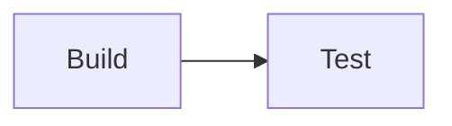

# 다이어그램 정책

문서·보고서·PR 설명의 구조 다이어그램(흐름, 아키텍처 계층, 상태 머신, 호출
시퀀스, 타임라인)은 항상 Mermaid 펜스 블록으로 작성합니다. ASCII/상자 그리기
문자로 그린 프레임 다이어그램은 금지입니다.

다이어그램은 펜스 태그로 종류를 선언하고, `graph`/`flowchart` 헤더는 방향을
선언해야 합니다:

## 렌더링 가능한 종류

플랫폼에서 렌더링되는 종류는 다음뿐입니다: `graph`/`flowchart`(방향 필수:
`TD`, `TB`, `BT`, `LR`, `RL`), `stateDiagram(-v2)`, `sequenceDiagram`,
`classDiagram`, `gantt`, `pie`, `quadrantChart`. 그 외 종류는 일반 코드 블록으로
물러나며 렌더링되는 문서에서는 금지입니다.

이 목록과 물러남 계약의 권위는 entelecheia
[communication-style.md의 Language Purity 규칙 6](https://github.com/celestia-island/entelecheia/blob/master/res/prompts/system/communication-style.md)이며,
충돌 시 이 파일이 우선합니다.

## 예외

일반 텍스트가 허용되는 경우:

- 디렉터리 트리 표기(`├──`, `└──`);
- 터미널/콘솔 출력 묘사(`console`, `terminal`, `ansi`, `output`, `text`
  태그의 펜스);
- 실행 결과의 일반 텍스트 출력.
- `text` 펜스는 터미널 출력 전용입니다. 프레임 다이어그램의 빠져나갈 구멍이 아닙니다;

## 강제

`celestia-devtools format-markdown`은 Mermaid 및 터미널 출력 펜스 밖의 상자
프레임 글리프를 검출합니다. ASCII 프레임 다이어그램은 Markdown 게이트에서
실패합니다.
