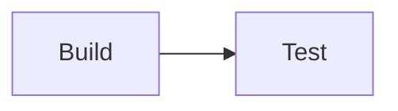

# Политика диаграмм

Структурные диаграммы — потоки, слои архитектуры, автоматы состояний,
последовательности вызовов, таймлайны — в документации, отчётах и описаниях PR
всегда записываются как блоки Mermaid в ограждениях. Диаграммы-рамки из
ASCII/псевдографики запрещены.

Диаграмма объявляет свой вид в теге ограждения, а заголовки `graph`/`flowchart`
обязаны объявлять направление:

## Отрисовываемые виды

Платформа отрисовывает только эти виды: `graph`/`flowchart` (направление
обязательно: `TD`, `TB`, `BT`, `LR` или `RL`), `stateDiagram(-v2)`,
`sequenceDiagram`, `classDiagram`, `gantt`, `pie`, `quadrantChart`. Любой другой
вид откатывается к обычному блоку кода и запрещён в отрисовываемых документах.

Авторитет для этого списка и контракта отката — entelecheia
[communication-style.md, правило 6 Language Purity](https://github.com/celestia-island/entelecheia/blob/master/res/prompts/system/communication-style.md);
при конфликте приоритет у этого файла.

## Исключения

Обычный текст остаётся допустимым для:

- перечислений дерева каталогов (`├──`, `└──`);
- изображений вывода терминала/консоли (ограждения с тегами `console`,
  `terminal`, `ansi`, `output` или `text`);
- текстового вывода выполнения программ.
- ограждение `text` — только для вывода терминала; это не лазейка для рамочных диаграмм;

## Принуждение

`celestia-devtools format-markdown` помечает глифы рамок вне ограждений Mermaid
и терминальных ограждений, поэтому ASCII-диаграмма не проходит Markdown-гейт.
