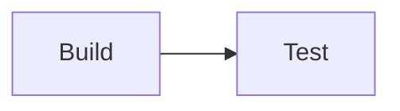

# 图表规范

文档、报告与 PR 描述中的结构图——流程、架构分层、状态机、调用时序、时间线——
一律写成 Mermaid 围栏代码块。禁止用 ASCII/制表符画框线图。

图表在围栏标签里声明种类，`graph`/`flowchart` 的首行必须声明方向：

## 可渲染种类

平台只渲染以下种类：`graph`/`flowchart`（必须声明方向：`TD`、`TB`、`BT`、
`LR`、`RL`）、`stateDiagram(-v2)`、`sequenceDiagram`、`classDiagram`、`gantt`、
`pie`、`quadrantChart`。其余种类会退回普通代码块，在渲染文档中禁止使用。

本清单与回退契约的唯一权威是 entelecheia 的
[communication-style.md 第 6 条（Language Purity）](https://github.com/celestia-island/entelecheia/blob/master/res/prompts/system/communication-style.md)；
有冲突时以该文件为准。

## 豁免

以下场景允许纯文本：

- 目录树列表（`├──`、`└──`）；
- 终端/控制台输出演示（`console`、`terminal`、`ansi`、`output`、`text`
  标签的围栏）；
- 程序运行时的纯文本输出。
- `text` 围栏只用于终端输出——它不是框线图的逃生口；

## 强制执行

`celestia-devtools format-markdown` 会标记 Mermaid 与终端输出围栏之外的框线
字形，ASCII 框线图无法通过 Markdown 门禁。
