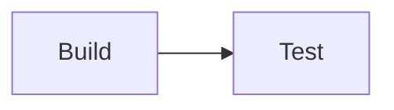

# 圖表規範

文件、報告與 PR 描述中的結構圖——流程、架構分層、狀態機、呼叫時序、時間線——
一律寫成 Mermaid 圍欄程式碼區塊。禁止以 ASCII/製表符繪製框線圖。

圖表在圍欄標籤裡宣告種類，`graph`/`flowchart` 的首行必須宣告方向：

## 可渲染種類

平台只渲染以下種類：`graph`/`flowchart`（必須宣告方向：`TD`、`TB`、`BT`、
`LR`、`RL`）、`stateDiagram(-v2)`、`sequenceDiagram`、`classDiagram`、`gantt`、
`pie`、`quadrantChart`。其餘種類會退回普通程式碼區塊，在渲染文件中禁止使用。

本清單與回退契約的唯一權威是 entelecheia 的
[communication-style.md 第 6 條（Language Purity）](https://github.com/celestia-island/entelecheia/blob/master/res/prompts/system/communication-style.md)；
有衝突時以該檔案為準。

## 豁免

以下場景允許純文字：

- 目錄樹列表（`├──`、`└──`）；
- 終端/主控台輸出示範（`console`、`terminal`、`ansi`、`output`、`text`
  標籤的圍欄）；
- 程式執行時的純文字輸出。
- `text` 圍欄只用於終端輸出——它不是框線圖的逃生口；

## 強制執行

`celestia-devtools format-markdown` 會標記 Mermaid 與終端輸出圍欄之外的框線
字元，ASCII 框線圖無法通過 Markdown 閘道。
